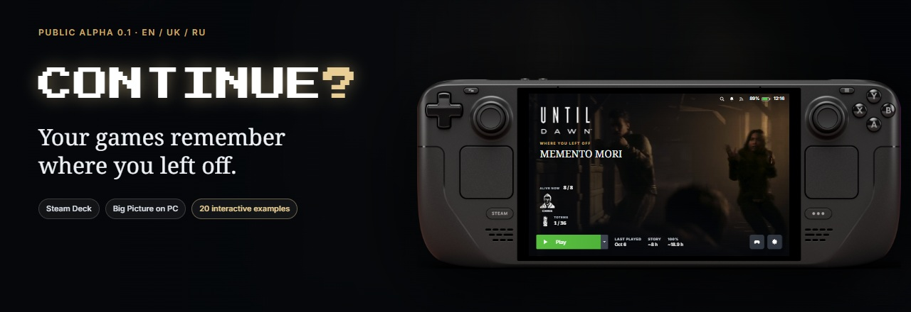
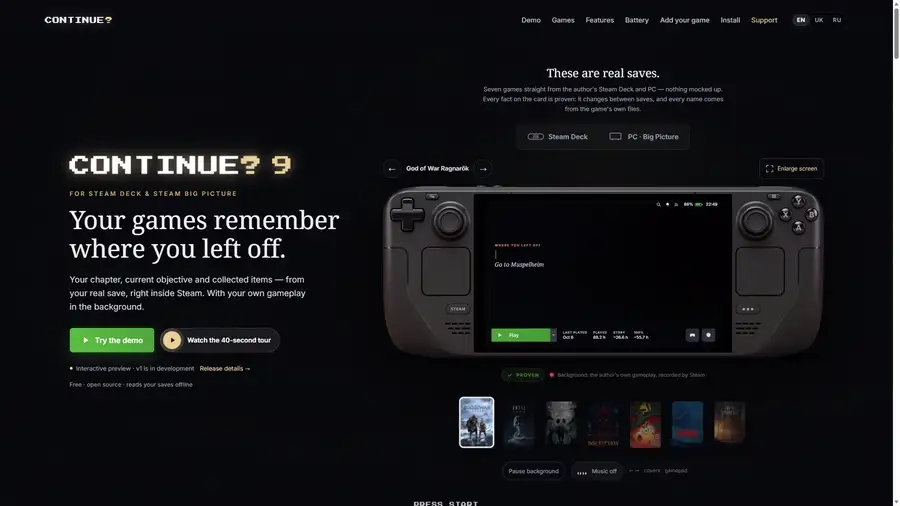
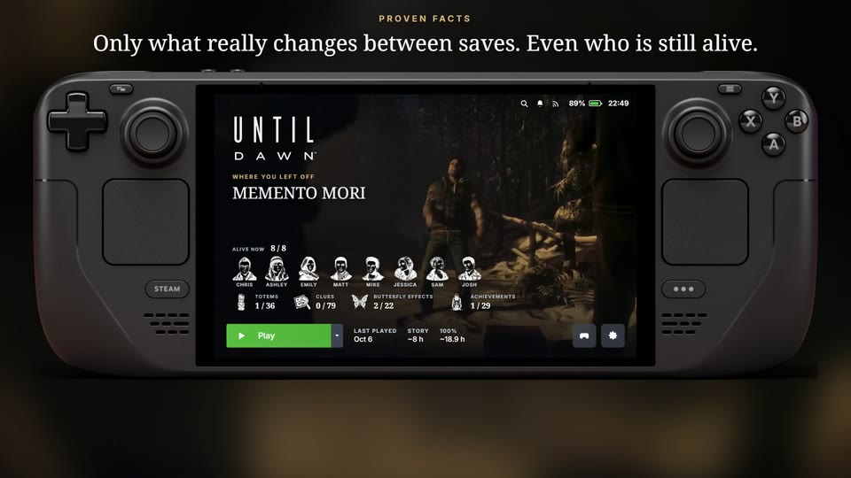
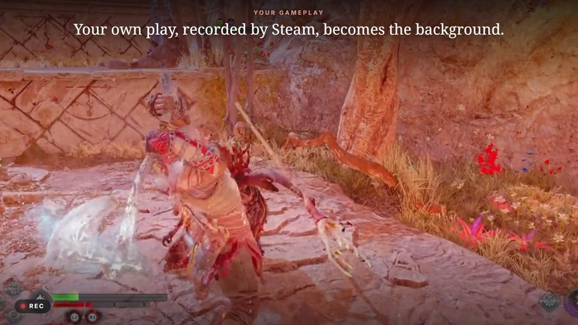
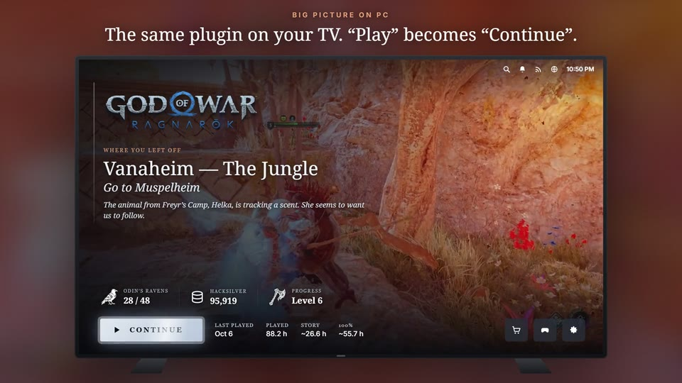
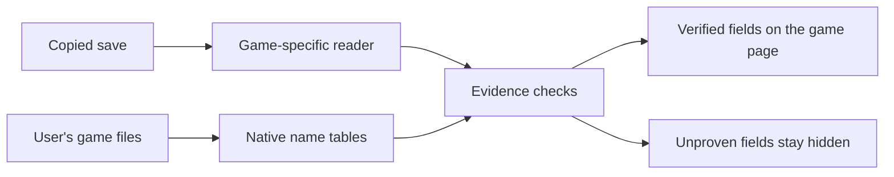

<div align="center">



**English** · [Українська](README.uk.md) · [Русский](README.ru.md)


**Remember the adventure. Pick up where you left off.**

</div>

> **Public alpha · Steam Deck: install from ZIP/URL through Decky · PC / Big Picture comes later; the package has not yet passed acceptance on a clean Windows PC.**

Continue? puts the last proven chapter, location, objective and useful facts from your save on the Steam game page. Come back after a week and see where you stopped before pressing Continue. Choose a Steam trailer, a YouTube trailer with your consent, your own Steam Game Recording clip or a still image as the background.

[Install on Steam Deck](docs/install-deck.md) · [Latest release](https://github.com/Alexsander720/continue/releases/latest) · [Alpha tester checklist](docs/alpha-testers.md) · [Try the browser showcase](docs/preview.md)

<div align="center">



<a href="docs/img/tour-en.mp4"><b>▶ Watch the Full HD tour</b></a>

<sub>Interface preview with the official Steam Deck OLED body. These are curated snapshots, not a connection to your Steam account.</sub>

</div>

<details>
<summary>On this page</summary>

- [Why Continue?](#why)
- [What is in the public alpha](#capabilities)
- [Highlights](#screenshots)
- [Supported save readers](#games)
- [Languages](#languages)
- [Install, update, and remove](#install)
- [Sending an alpha report](#report)
- [Browser showcase](#showcase)
- [How it gets the facts](#evidence)
- [Battery and performance](#battery)
- [Development checks](#development)
- [What is next](#roadmap)
- [Questions](#faq)
- [Support](#support)
- [License and credits](#license)

</details>

<a id="why"></a>

## Why Continue?

Steam tells you which game you own and when you last played. Continue? adds the context that helps you **continue the game itself**:

- **Return to a story:** the saved chapter, area and objective, when the game stores them.
- **Remember your progress:** collectibles, equipment, currency or surviving characters, depending on the game.
- **Enjoy opening the library:** your own recorded gameplay or a trailer behind the logo, with game art and optional theme music.
- **Stay on the sofa:** the information belongs on the game page, alongside Steam's existing controls.

<a id="capabilities"></a>

## What is in the public alpha

- A self-contained Decky plugin; no PC helper is required on Deck.
- EN, UK, and RU interface text. Save labels and chapter names come from the game or save where proven; if a game has no Ukrainian text, that reader falls back to its verified English text.
- Per-game background source: Steam, YouTube, Steam Game Recording, or artwork. YouTube and theme-music downloads require separate, explicit consent.
- Light, Balanced, and Maximum media presets. Light and Balanced cap video at 720p; Maximum caps it at 1080p. The cache budget is selected separately (1, 2, 4, or 8 GB).
- A live background on the game page and, when enabled by the selected preset, on Steam Home.
- An optional brightness bar and a setting that avoids duplicating the separate Brightness Bar plugin.
- Daily release checks. Decky is given the release ZIP and its matching SHA-256; Continue? does not replace its own files directly.
- **Collect a developer report** in the `…` menu. You see the complete sanitized JSON before saving the ZIP.

The plugin reads saves and never writes them. Its display is based on the last save, so it may lag behind unsaved gameplay.

<a id="screenshots"></a>

## Highlights

These images are curated interface previews. The Big Picture image shows a prototype; Windows acceptance is still pending. The tour and screenshots do not prove every reader field.

<table>
<tr>
<td width="33%"></td>
<td width="33%"></td>
<td width="33%"></td>
</tr>
<tr>
<td valign="top"><b>Saved context and facts</b><br>Until Dawn: chapter, collectibles and surviving characters.</td>
<td valign="top"><b>Your own gameplay</b><br>God of War Ragnarök: the author's Steam recording behind the logo.</td>
<td valign="top"><b>Big Picture prototype</b><br>A TV layout preview; the PC package has not passed clean Windows acceptance.</td>
</tr>
</table>

<a id="games"></a>

## Supported save readers

The fields below come from the committed golden snapshots. Values that are absent in a fixture are not invented.

|   | Game | Proven fields shown by the golden snapshots |
| :-: |---|---|
| — | Alan Wake | place, chapter; coffee thermoses, chests, can pyramids, TV and radio shows, signs |
|  | Clair Obscur: Expedition 33 | place, chapter, objective; party levels, story progress, save time |
|  | God of War Ragnarök† | reader included; no local fixture was available for this golden run |
|  | Hollow Knight | place; completion, time, geo, masks, nail, spells, abilities, charms, grubs, dreamers |
|  | Horizon Forbidden West | quest text as place/chapter; Aloy's level and play time |
|  | Inscryption | deck, lives, teeth, highest damage |
|  | It Takes Two | place, chapter; chapter group and unlocked minigames |
|  | Life is Strange 2 | place, chapter; episode, completed episodes, souvenirs, journal, brotherhood and morality |
|  | Life is Strange: Double Exposure | place, chapter; episode and photos |
|  | Little Nightmares | place, chapter; nomes, statues and DLC items |
|  | Little Nightmares II | place, chapter and save time |
|  | Marvel's Spider-Man 2 | place, chapter, objective; completion, level, story, photos, Prowler stashes and Spider-Bots |
|  | NieR:Automata | place, chapter; character, route, level, gold, quests, weapons and endings |
|  | Nine Sols | place; time, level, deaths, seals, skills, jades and encyclopedia progress |
|  | REANIMAL | place, chapter; chapter number, gameplay time, finds, masks and posters |
|  | SILENT HILL 2 | place; health, ammunition, healing, kills, weapons, maps and memos |
|  | Slay the Spire | act/floor, character, ascension, wins, HP and gold |
|  | The Last of Us Part II Remastered† | reader included; no local fixture was available for this golden run |
|  | UNDERTALE | area; LV, HP, G, time, kills, weapons and armor |
| — | Uncharted: Legacy of Thieves Collection | chapter; completion, treasures and play time |
|  | Until Dawn | place, chapter; survivors, butterfly effects, clues and totems |

 **Hogwarts Legacy — PC only.** Its Oodle-compressed saves require the native `ooz` module, which is absent from Decky Python. It is excluded from Steam Deck support until a portable Oodle decoder is available.

† The golden test deliberately skips a reader when its research fixture is not present. These two readers ship, but this table does not claim fields that were unavailable to the current golden run.

Sally Face and Alice: Madness Returns are not registered: the available material did not prove a reader across the required stages. ENSLAVED, LEGO Harry Potter, and Bleach readers are also excluded from the public build.

<a id="languages"></a>

## Languages

The plugin interface is translated directly to English, Ukrainian, and Russian. Reader output is more conservative: names must be demonstrated by the save or by localized game files. This means a field can remain in English when the installed game data does not contain a proven Ukrainian string. Uncharted is such a case: the archive marked `uke` contains English, so its Ukrainian reader output intentionally uses verified English chapter text.

<a id="install"></a>

## Install, update, and remove

**Steam Deck:** download `continue-deck-<version>.zip` and its matching `.sha256` from the [latest release](https://github.com/Alexsander720/continue/releases/latest). Do not unpack the ZIP. This alpha is not in the Decky store. Install the ZIP or its direct asset URL through **Decky → Settings → Developer → Install from URL/ZIP**. Keep the checksum next to the ZIP when distributing a release. Installation, recovery, updates and removal are covered in the [Steam Deck guide](docs/install-deck.md).

In Decky’s plugin list the name is **Continue** (Decky cannot load a plugin name containing `?`); inside the interface it is **Continue?**.

**Windows / Big Picture comes later.** A separate `continue-pc-<version>.zip` package and `setup.cmd` installer have been tested with fixtures: per-user setup without administrator rights, repair, status, update rollback and uninstall. Acceptance with real Steam, SmartScreen and antivirus on a clean Windows PC is still pending. It is not part of the Deck release. The [PC guide](docs/install-pc.md) explains the local Steam debugging flag, consent, setup and removal.

<a id="report"></a>

## Sending an alpha report

Open Continue?'s `…` menu and select **Collect a developer report**. The preview contains versions that are available, language and settings, the plugin log tail, installed-game reader outcomes with parse time, and background-cache state. It contains no save files or media. User names, profile paths, and Steam IDs are redacted. Review the preview, save the ZIP to Desktop or Downloads, and attach it to the matching [alpha issue template](.github/ISSUE_TEMPLATE/alpha_tester_report.md).

See the [full tester checklist](docs/alpha-testers.md) before reporting layout, reader, or media problems.

<a id="showcase"></a>

## Browser showcase

The website is a curated demonstration, not a Steam connection:

```text
python tools/preview.py
```

Open <http://127.0.0.1:8811/>. No Steam account or installed game is needed. The 20 interactive examples are fixed snapshots; the supported-reader catalog contains 22 public-alpha games.

<a id="evidence"></a>

## How it gets the facts

The reading flow is: **copy a save → parse known fields → resolve names from your own game files → display only verified facts**. It reads saved state; it does not describe events that have not been saved.



- **Meaning before numbers.** Compare several stages of the same playthrough and check what the field actually means. A mechanical gate alone cannot prove that an offset is “collectibles”.
- **Names from the game.** No chapter names recalled from memory or silently translated by an AI. If a verified translation is unavailable, preserve the source language and label it.
- **Totals from native data.** “12 / 40” needs evidence for both values. A wiki total or unlocked chapter number is not a substitute for the current saved chapter.
- **Read-only and local.** Parse copies; do not write into saves, game folders or game processes. The browser demo uses bundled snapshots and never reads a visitor's saves.

The public alpha includes game-specific Python readers and selected runtime name tables. Contributions follow [AGENTS.md](AGENTS.md) and [CONTRIBUTING.md](CONTRIBUTING.md); unsupported fields stay hidden.

<a id="battery"></a>

## Battery and performance

Preliminary measurements on the author's **Steam Deck OLED, 6 October 2026**: whole-device battery draw, 45-second average, brightness 13%, Wi-Fi enabled.

| Screen | Power |
|---|---:|
| Game page, still background | 4.93 W |
| Game page, 1080p loop + music | 6.46 W |
| Steam home, without our video | 7.69 W |
| Steam home, loop + music | 8.07 W |

In this setup the animated game page added about **1.5 W**. This is a short measurement of a particular interface state, **not a gaming battery-life benchmark**. Background-only battery-life estimates on the website assume a 50 Wh battery; actual play time depends on the game and settings.

The released presets are **Light, Balanced and Maximum**. Light is the default: it suppresses Home video and uses a still image on battery. Light and Balanced cap video at 720p; Maximum caps it at 1080p. The cache budget is separate: 1, 2, 4 or 8 GB. These controls are described in the [Steam Deck guide](docs/install-deck.md); the older measurements above are not an alpha battery-life guarantee.

<a id="development"></a>

## Development checks

The public export has no runtime dependency beyond what is already packaged. Useful local checks are:

```text
python tools/check_links.py
node --check site/app.js
node --check site/data.js
python tools/preview.py
```

Reader changes are reviewed through deterministic JSON golden snapshots. Updating them requires the explicit `--update` command; an ordinary test run never rewrites baselines.

<a id="roadmap"></a>

## What is next

Next comes acceptance on clean Deck LCD and OLED devices: installation, update/removal, controller focus, suspend/resume, offline behavior, media fallback and cache limits. Windows / Big Picture needs separate acceptance on a clean PC with real Steam before release.

The [roadmap](docs/ROADMAP.md) lists the remaining checks, and the [changelog](CHANGELOG.md) records released changes. Dates and compatibility are not promised.

<a id="faq"></a>

## Questions

<details>
<summary><b>Can I install Continue? now?</b></summary>

Yes, on Steam Deck: install the [latest release ZIP](https://github.com/Alexsander720/continue/releases/latest) through Decky. Follow the [Deck guide](docs/install-deck.md). Windows / Big Picture comes later; its separate package has not passed clean Windows acceptance.

</details>

<details>
<summary><b>Does it support every game?</b></summary>

Saved chapters and facts require a game-specific reader and evidence. See the [reader table](#games), including the missing-fixture notes and the PC-only Oodle limitation. A library entry alone does not provide save support.

</details>

<details>
<summary><b>Are the browser demo numbers live?</b></summary>

No. The 20 interactive examples are fixed snapshots. The browser showcase does not connect to Steam or read your saves; the installed plugin reads the last local save.

</details>

<details>
<summary><b>Does AI guess my progress?</b></summary>

Displayed facts come from save and game-file evidence. An AI coding agent can help research a reader, but a plausible answer is not proof.

</details>

<details>
<summary><b>Why is there no music button in my clone?</b></summary>

Theme audio is excluded from Git. The browser demo hides the control when no local theme file is available. In the plugin, theme-music and YouTube downloads require separate explicit consent.

</details>

<details>
<summary><b>Will it work after every Steam update?</b></summary>

The plugin depends on Steam’s interface, so client updates need compatibility checks. The alpha does not guarantee support for every client version. Use the [tester checklist](docs/alpha-testers.md) when reporting problems.

</details>

<details>
<summary><b>How can I help?</b></summary>

Report alpha or showcase bugs, improve translations, document save locations or prepare evidence from several stages of one playthrough. Read [CONTRIBUTING.md](CONTRIBUTING.md) before submitting files.

</details>

<a id="support"></a>

## Support

Continue? is free and always will be. If it made you want to play again, you can help keep it going —
every donation goes into development and the AI subscription that helps build it.

<table align="center"><tr>
<td align="center"><br><b>monobank jar</b></td>
<td align="center"><br><b>USDT · TRC20</b></td>
<td align="center"><br><b>USDT · BEP20</b></td>
</tr></table>

- **monobank jar** — <https://send.monobank.ua/jar/3zsHTXdRbt> · jar card `4874 1000 3320 3608`
- **PayPal** — [unchanged payment details on the project site](https://alexsander720.github.io/continue/#support)
- **USDT · TRC20** (Tron) — `TKhmtVEnuU5w73YMPT8adh7t3VZKJUUxmC`
- **USDT · BEP20** (BNB Smart Chain) — `0xDC0c682922bF3194693774743fBB3fd20E7754c3`

<a id="license"></a>

## License and credits

Code is **GNU GPL v3** with the existing section 7 terms in [NOTICE.md](NOTICE.md): retain author attribution, identify modifications, and use a different name/logo for a distributed fork. See [LICENSE](LICENSE).

Game names, logos, artwork and footage retain their owners' rights; the code license does not license those media. Game icons and character portraits identify games for informational, non-commercial purposes (removal requests can be submitted via the issue tracker). YouTube trailers and theme music are fetched only with your consent, locally on your device; the project ships no third-party audio or video. The showcase uses the official Valve Steam Deck OLED rendering as a device frame. [Asset sources](site/img/ASSET_SOURCES.md) · [Demo sources](site/DEMO_SOURCES.md). Continue? is independent and is not affiliated with Valve.

**Continue? by Doctor_Nerd — https://github.com/Alexsander720/continue**

<div align="center"><sub>Made in Ukraine by Doctor_Nerd · <a href="https://github.com/Alexsander720">@Alexsander720</a></sub></div>
