<div align="center">

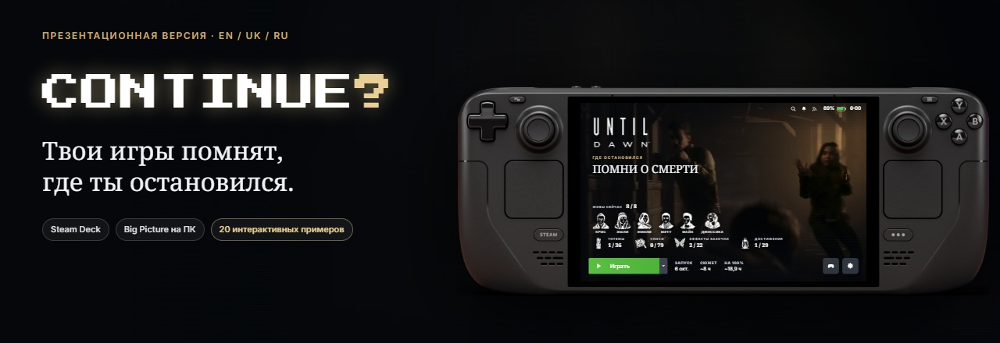

[English](README.md) · [Українська](README.uk.md) · **Русский**


**Вспомни приключение. Продолжи с того места, где остановился.**

</div>

> **Публичная альфа 0.1.0 · Steam Deck: установка из ZIP/URL через Decky · ПК/Big Picture — позже, пакет ещё не принят на чистой Windows.**

Continue? добавляет на страницу игры в Steam последнюю доказанную главу, место, цель и полезные факты из сохранения. Вернулся через неделю? Вспомни, где остановился, прежде чем нажать «Продолжить». Фоном можно выбрать трейлер Steam, трейлер YouTube с твоего согласия, свою запись Steam Game Recording или статичную иллюстрацию.

[Установка на Steam Deck](docs/install-deck.ru.md) · [Релиз v0.1.0](https://github.com/Alexsander720/continue/releases/tag/v0.1.0) · [Памятка альфа-тестера](docs/alpha-testers.ru.md) · [Запустить витрину](docs/preview.ru.md)

<div align="center">

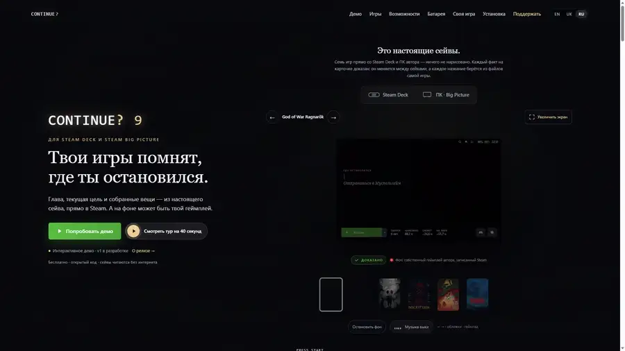

<a href="docs/img/tour-ru.mp4"><b>▶ Смотреть тур в Full HD</b></a>

<sub>Демонстрация интерфейса в официальном корпусе Steam Deck OLED. Здесь выбраны снимки сохранений; подключения к твоему аккаунту Steam нет.</sub>

</div>

<details>
<summary>На этой странице</summary>

- [Ради чего Continue?](#why)
- [Что есть в альфе 0.1.0](#capabilities)
- [Главное](#screenshots)
- [Поддерживаемые читатели сохранений](#games)
- [Языки](#languages)
- [Установка, обновление и удаление](#install)
- [Отчёт альфа-тестера](#report)
- [Браузерная витрина](#showcase)
- [Откуда берутся факты](#evidence)
- [Батарея и производительность](#battery)
- [Проверки для разработчиков](#development)
- [Что дальше](#roadmap)
- [Вопросы](#faq)
- [Поддержать](#support)
- [Лицензия и авторство](#license)

</details>

<a id="why"></a>

## Ради чего Continue?

Steam показывает, какая игра у тебя есть и когда ты её запускал. Continue? добавляет контекст, с которым проще **продолжить само прохождение**:

- **Вернуться в историю:** сохранённая глава, область и задание, если игра их хранит.
- **Вспомнить прогресс:** находки, снаряжение, валюта или выжившие персонажи — в зависимости от игры.
- **Получить удовольствие от библиотеки:** свой записанный геймплей или трейлер за логотипом, оформление игры и необязательная музыка темы.
- **Остаться на диване:** информация находится прямо на странице игры, рядом с привычными кнопками Steam.

<a id="capabilities"></a>

## Что есть в альфе 0.1.0

- Самодостаточный плагин Decky: для работы на Деке помощник на ПК не нужен.
- Интерфейс на EN, UK и RU. Названия из сохранений берутся из игры или сейва, если это доказано; когда в игре нет подтверждённого украинского текста, читатель оставляет проверенный английский.
- Источник фона отдельно для каждой игры: Steam, YouTube, Steam Game Recording или картинка. Загрузка с YouTube и музыки темы требует двух отдельных явных согласий.
- Пресеты «Лёгкий», «Сбалансированный» и «Максимум». Первые два ограничивают видео 720p, «Максимум» — 1080p. Лимит кэша выбирается отдельно: 1, 2, 4 или 8 ГБ.
- Живой фон на странице игры и, если разрешает пресет, на главной Steam.
- Необязательная полоса яркости; при наличии отдельного Brightness Bar дублирование отключается.
- Ежедневная проверка релизов. Плагин передаёт Decky ZIP релиза и соответствующий SHA-256, а не заменяет свои файлы сам.
- **«Собрать отчёт для разработчика»** в меню `…`: перед сохранением ZIP виден весь обезличенный JSON.

Плагин только читает сохранения и никогда не пишет в них. Показывается состояние последнего сейва, поэтому несохранённые события могут отсутствовать.

<a id="screenshots"></a>

## Главное

Это выбранные кадры демонстрации интерфейса. На кадре Big Picture показан прототип; приёмка Windows ещё впереди. Тур и скриншоты не доказывают все поля читателей.

<table>
<tr>
<td width="33%">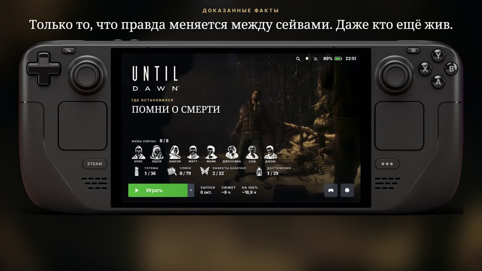</td>
<td width="33%">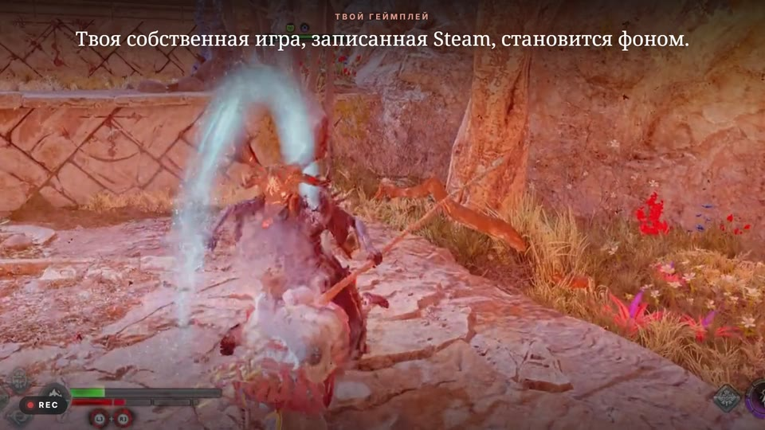</td>
<td width="33%">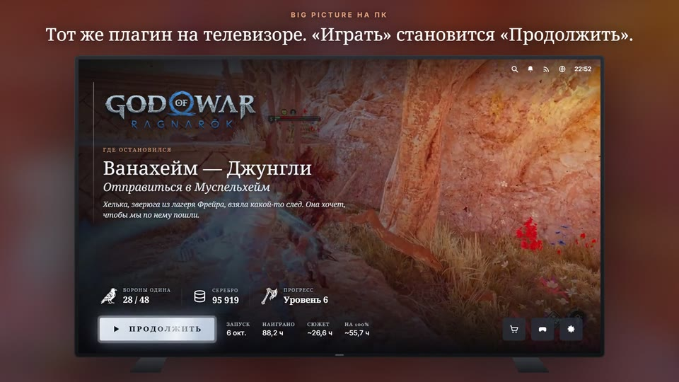</td>
</tr>
<tr>
<td valign="top"><b>Контекст и факты</b><br>Until Dawn: глава, находки и выжившие персонажи.</td>
<td valign="top"><b>Свой геймплей</b><br>God of War Ragnarök: запись Steam автора за логотипом.</td>
<td valign="top"><b>Прототип Big Picture</b><br>Пример раскладки для телевизора; пакет ПК ещё не принят на чистой Windows.</td>
</tr>
</table>

<a id="games"></a>

## Поддерживаемые читатели сохранений

Поля ниже взяты из зафиксированных golden-эталонов. Отсутствующие в фикстуре значения не додумываются.

|   | Игра | Доказанные поля в golden-эталонах |
| :-: |---|---|
| — | Alan Wake | место, глава; термосы, сундуки, пирамиды из банок, ТВ, радио и знаки |
| 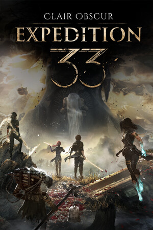 | Clair Obscur: Expedition 33 | место, глава, цель; уровни группы, сюжет и время сейва |
| 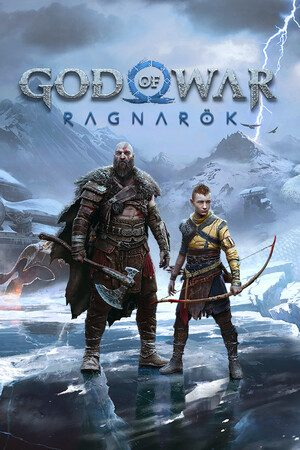 | God of War Ragnarök† | читатель включён; локальной фикстуры для этого golden-прогона не было |
| 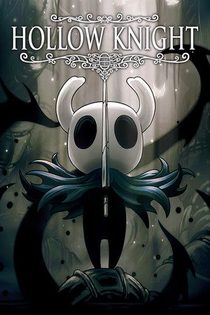 | Hollow Knight | место; завершение, время, гео, маски, гвоздь, заклинания, способности, амулеты, гусеницы и грезящие |
| 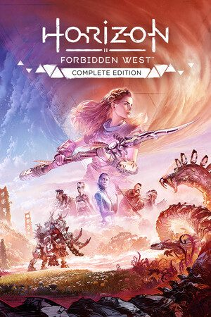 | Horizon Forbidden West | текст задания как место/глава; уровень Элой и время игры |
| 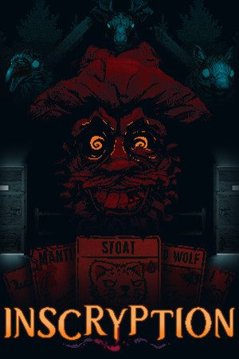 | Inscryption | колода, жизни, зубы и максимальный урон |
| 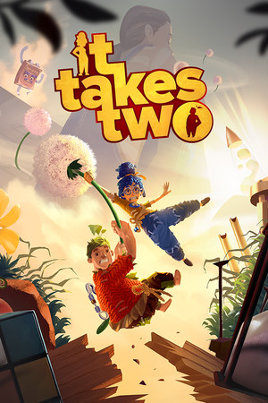 | It Takes Two | место, глава; группа главы и открытые мини-игры |
| 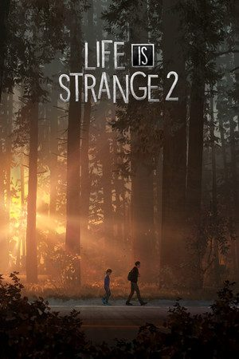 | Life is Strange 2 | место, глава; эпизод, завершённые эпизоды, сувениры, дневник, братство и мораль |
| 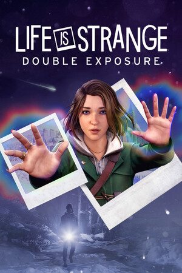 | Life is Strange: Double Exposure | место, глава; эпизод и фотографии |
| 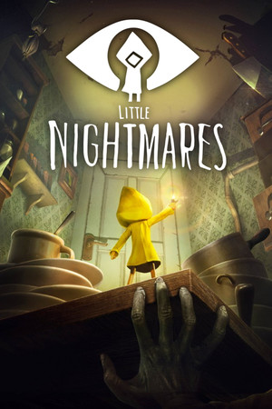 | Little Nightmares | место, глава; номы, статуэтки и предметы DLC |
| 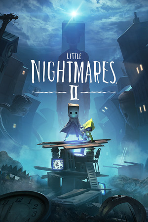 | Little Nightmares II | место, глава и время сейва |
| 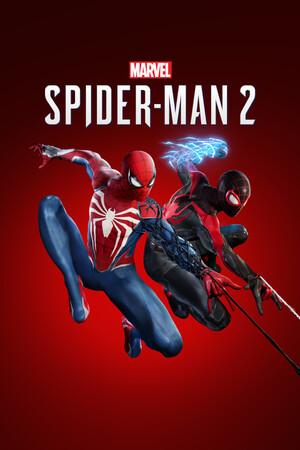 | Marvel's Spider-Man 2 | место, глава, цель; процент, уровень, сюжет, фото, тайники Бродяги и пауки-боты |
| 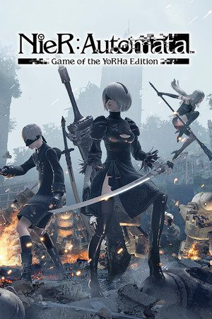 | NieR:Automata | место, глава; персонаж, маршрут, уровень, золото, задания, оружие и концовки |
| 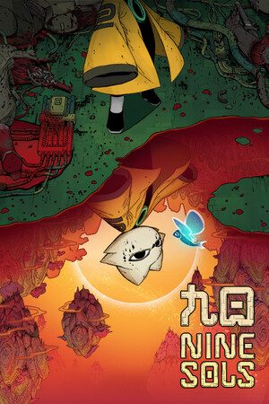 | Nine Sols | место; время, уровень, смерти, печати, навыки, нефриты и энциклопедия |
| 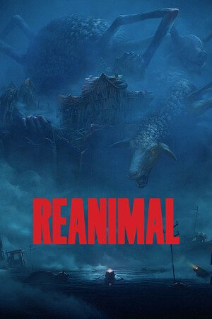 | REANIMAL | место, глава; номер главы, время, находки, маски и плакаты |
| 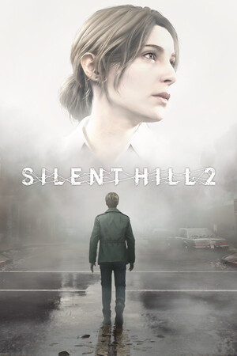 | SILENT HILL 2 | место; здоровье, патроны, лечение, убийства, оружие, карты и записки |
| 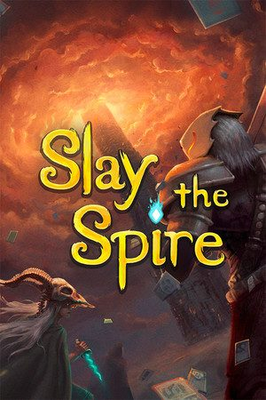 | Slay the Spire | акт/этаж, персонаж, возвышение, победы, здоровье и золото |
| 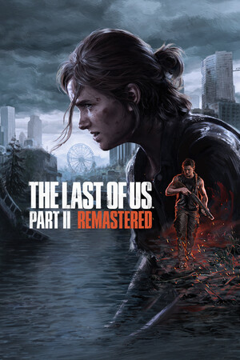 | The Last of Us Part II Remastered† | читатель включён; локальной фикстуры для этого golden-прогона не было |
| 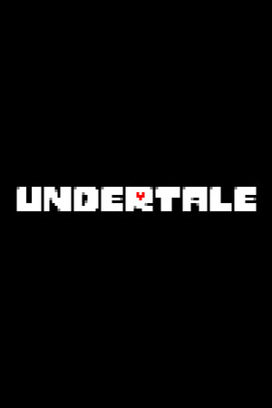 | UNDERTALE | область; LV, HP, G, время, убийства, оружие и броня |
| — | Uncharted: Legacy of Thieves Collection | глава; завершение, сокровища и время игры |
| 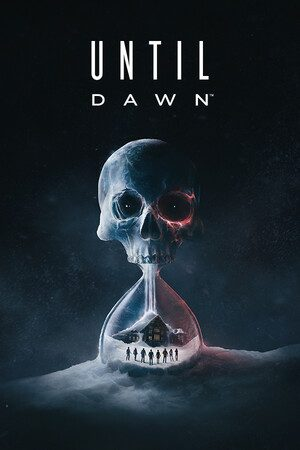 | Until Dawn | место, глава; выжившие, эффекты бабочки, улики и тотемы |

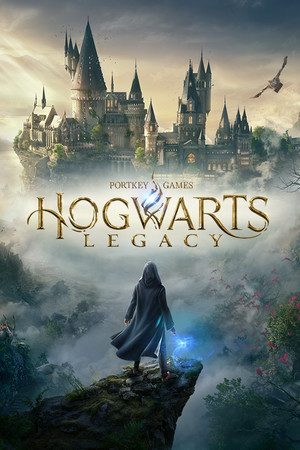 **Hogwarts Legacy — только ПК.** Для Oodle-сжатых сейвов нужен нативный модуль `ooz`, которого нет в Python Decky. Поддержка на Steam Deck исключена до появления переносимого Oodle-декомпрессора.

† Golden-тест намеренно пропускает читателя, когда исследовательской фикстуры нет. Оба читателя входят в сборку, но таблица не обещает поля, которых не было в текущем golden-прогоне.

Sally Face и Alice: Madness Returns не зарегистрированы: имеющиеся материалы не подтверждают работу читателя на требуемых этапах. Читатели ENSLAVED, LEGO Harry Potter и Bleach также исключены из публичной сборки.

<a id="languages"></a>

## Языки

Интерфейс плагина непосредственно переведён на английский, украинский и русский. Данные читателей строже: название должно быть доказано сейвом или локализованными файлами игры. Поэтому поле может остаться английским, если в установленных данных игры нет подтверждённой украинской строки. Так устроен Uncharted: архив с меткой `uke` содержит английский текст, поэтому украинский режим намеренно показывает проверенные английские главы.

<a id="install"></a>

## Установка, обновление и удаление

**Steam Deck:** скачай `continue-deck-0.1.0.zip` и соответствующий `.sha256` из [релиза v0.1.0](https://github.com/Alexsander720/continue/releases/tag/v0.1.0). ZIP распаковывать не нужно. Альфы ещё нет в магазине Decky. Установи ZIP или прямую ссылку на этот файл через **Decky → Настройки → Разработчик → Установить из URL/ZIP**. При распространении релиза контрольная сумма должна лежать рядом с ZIP. Установка, восстановление, обновление и удаление описаны в [инструкции для Steam Deck](docs/install-deck.ru.md).

В списке плагинов Decky имя — **Continue** (Decky не загружает имя с `?`); внутри интерфейса — **Continue?**.

**Windows / Big Picture — позже.** Отдельный пакет `continue-pc-<версия>.zip` и установщик `setup.cmd` проверены на фикстурах: установка в профиль без прав администратора, ремонт, status, откат обновления и удаление. Приёмка на чистой Windows с настоящим Steam, SmartScreen и антивирусом ещё впереди. В релиз Deck 0.1.0 этот пакет не входит. В [инструкции для ПК](docs/install-pc.ru.md) описаны локальный отладочный флаг Steam, согласие на него, установка и удаление.

<a id="report"></a>

## Отчёт альфа-тестера

Открой меню `…` Continue? и выбери **«Собрать отчёт для разработчика»**. В предпросмотре будут доступные версии, язык и настройки, хвост лога, результаты читателей установленных игр со временем разбора и состояние кэша фонов. Сейвы и медиа в ZIP не попадают; имена, пути профиля и Steam ID скрываются. Проверь текст, сохрани ZIP на Рабочий стол или в Загрузки и приложи к [шаблону отчёта](.github/ISSUE_TEMPLATE/alpha_tester_report.ru.md).

Перед проверкой прочитай [памятку альфа-тестера](docs/alpha-testers.ru.md).

<a id="showcase"></a>

## Браузерная витрина

Сайт — это набор фиксированных примеров, а не подключение к Steam:

```text
python tools/preview.py
```

Открой <http://127.0.0.1:8811/>. Аккаунт Steam и установленные игры не нужны. В витрине 20 интерактивных снимков; в каталоге публичной альфы 22 читателя.

<a id="evidence"></a>

## Откуда берутся факты

Порядок чтения: **копия сохранения → разбор известных полей → названия из твоих файлов игры → только подтверждённые факты на экране**. Это сохранённое состояние; события после последнего сохранения здесь не появляются.

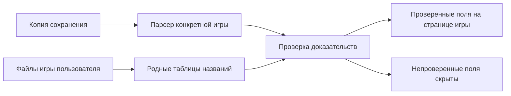

- **Сначала смысл числа.** Сравниваем этапы одного прохождения и проверяем, что именно означает поле. Успешная автоматическая проверка сама по себе не доказывает, что смещение — это «находки».
- **Названия из игры.** Без глав по памяти и незаметного перевода ИИ. Если подтверждённого перевода нет, сохраняем язык источника и подписываем его.
- **Общие количества из родных данных.** Для «12 / 40» нужны доказательства обеих частей. Число из вики или номер последней открытой главы не заменяют текущую сохранённую главу.
- **Только чтение, локально.** Разбираются копии; не записываем в сохранения, папки и процессы игр. Браузерное демо использует готовые снимки и не читает сейвы посетителя.

Публичная альфа включает читатели на Python для конкретных игр и выбранные таблицы названий для карточек. Правила вклада — в [AGENTS.md](AGENTS.md) и [CONTRIBUTING.md](CONTRIBUTING.md); неподтверждённые поля остаются скрытыми.

<a id="battery"></a>

## Батарея и производительность

Предварительный замер на **Steam Deck OLED автора, 6 октября 2026**: расход всего устройства от батареи, среднее за 45 секунд, яркость 13%, Wi-Fi включён.

| Экран | Мощность |
|---|---:|
| Страница игры, неподвижный фон | 4,93 Вт |
| Страница игры, петля 1080p + музыка | 6,46 Вт |
| Главная Steam без нашего видео | 7,69 Вт |
| Главная Steam, петля + музыка | 8,07 Вт |

В этих условиях живая страница добавила около **1,5 Вт**. Это короткий замер конкретного экрана, **не тест времени работы в игре**. Оценки часов на сайте рассчитаны для батареи 50 Вт·ч при таком экране; реальная игра расходует энергию по-своему.

В альфе уже есть пресеты **«Лёгкий», «Сбалансированный» и «Максимум»**. По умолчанию выбран «Лёгкий»: без видео на главной и со статичным фоном от батареи. Первые два ограничивают видео 720p, «Максимум» — 1080p. Лимит кэша выбирается отдельно: 1, 2, 4 или 8 ГБ. Настройки описаны в [инструкции для Steam Deck](docs/install-deck.ru.md); старые замеры выше не гарантируют время работы альфы от батареи.

<a id="development"></a>

## Проверки для разработчиков

```text
python tools/check_links.py
node --check site/app.js
node --check site/data.js
python tools/preview.py
```

Изменения читателей сравниваются с детерминированными JSON golden-эталонами. Они обновляются только явной командой `--update`; обычный тест никогда не переписывает базу.

<a id="roadmap"></a>

## Что дальше

Дальше — приёмка на чистых Deck LCD и OLED: установка, обновление и удаление, фокус контроллера, сон и пробуждение, работа без сети, статичный фон при сбоях и лимиты кэша. Windows / Big Picture перед выпуском требует отдельной приёмки на чистом ПК с настоящим Steam.

Оставшиеся проверки перечислены в [дорожной карте](docs/ROADMAP.md), выпущенные изменения — в [журнале](CHANGELOG.md). Сроки и совместимость заранее не обещаем.

<a id="faq"></a>

## Вопросы

<details>
<summary><b>Можно уже установить Continue?</b></summary>

Да, на Steam Deck: установи ZIP [релиза 0.1.0](https://github.com/Alexsander720/continue/releases/tag/v0.1.0) через Decky по [инструкции](docs/install-deck.ru.md). Windows / Big Picture — позже: отдельный пакет ещё не принят на чистой Windows.

</details>

<details>
<summary><b>Поддерживается любая игра?</b></summary>

Для глав и фактов нужен читатель конкретной игры и доказательства. Смотри [таблицу читателей](#games), включая оговорки об отсутствующих фикстурах и ограничение Oodle на Деке. Запись в библиотеке сама по себе не даёт поддержку сейвов.

</details>

<details>
<summary><b>Числа в браузерном демо обновляются из моего Steam?</b></summary>

Нет. Все 20 интерактивных примеров — фиксированные снимки. Витрина не подключается к Steam и не читает твои сейвы; установленный плагин читает последнее локальное сохранение.

</details>

<details>
<summary><b>ИИ угадывает мой прогресс?</b></summary>

Показанные факты подтверждаются сейвами и файлами игры. ИИ-агент может помочь исследовать читатель, но правдоподобный ответ сам по себе не становится доказательством.

</details>

<details>
<summary><b>Почему в клоне нет кнопки музыки?</b></summary>

Музыка тем исключена из Git. Демо скрывает кнопку, если локального файла темы нет. В плагине загрузка музыки темы и трейлеров YouTube требует двух отдельных явных согласий.

</details>

<details>
<summary><b>Будет работать после любого обновления Steam?</b></summary>

Плагин зависит от интерфейса Steam, поэтому после обновлений клиента нужна проверка совместимости. Альфа не гарантирует работу с каждой версией. Для отчёта о проблемах используй [памятку тестера](docs/alpha-testers.ru.md).

</details>

<details>
<summary><b>Как помочь проекту?</b></summary>

Сообщить об ошибке альфы или витрины, улучшить переводы, описать пути сейвов или подготовить доказательства по нескольким этапам одного прохождения. Перед отправкой файлов прочитай [CONTRIBUTING.md](CONTRIBUTING.md).

</details>

<a id="support"></a>

## Поддержать

Continue? бесплатен и останется бесплатным. Если он вернул тебе желание поиграть — можно помочь проекту жить:
каждый донат идёт в разработку и в подписку на ИИ, с которым он строится.

<table align="center"><tr>
<td align="center"><br><b>Банка monobank</b></td>
<td align="center"><br><b>USDT · TRC20</b></td>
<td align="center"><br><b>USDT · BEP20</b></td>
</tr></table>

- **Банка monobank** — <https://send.monobank.ua/jar/3zsHTXdRbt> · карта банки `4874 1000 3320 3608`
- **PayPal** — [неизменённые реквизиты на сайте проекта](https://alexsander720.github.io/continue/#support)
- **USDT · TRC20** (Tron) — `TKhmtVEnuU5w73YMPT8adh7t3VZKJUUxmC`
- **USDT · BEP20** (BNB Smart Chain) — `0xDC0c682922bF3194693774743fBB3fd20E7754c3`

<a id="license"></a>

## Лицензия и авторство

Код — **GNU GPL v3** с существующими условиями раздела 7 в [NOTICE.md](NOTICE.md): сохранять авторство, обозначать изменения и использовать другое имя/логотип для распространяемого форка. Текст лицензии: [LICENSE](LICENSE).

Названия, логотипы, иллюстрации и видео игр сохраняют права их владельцев; лицензия кода не передаёт права на эти медиа. Корпус в витрине — официальный рендер Steam Deck OLED от Valve. [Источники ресурсов](site/img/ASSET_SOURCES.md) · [Источники демо](site/DEMO_SOURCES.md). Continue? — независимый проект, не связанный с Valve.

**Continue? by Doctor_Nerd — https://github.com/Alexsander720/continue**

<div align="center"><sub>Сделано в Украине, автор — Doctor_Nerd · <a href="https://github.com/Alexsander720">@Alexsander720</a></sub></div>
