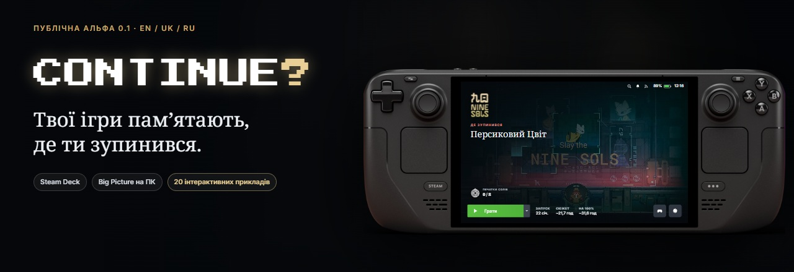
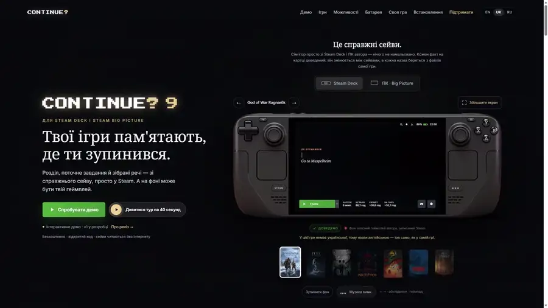
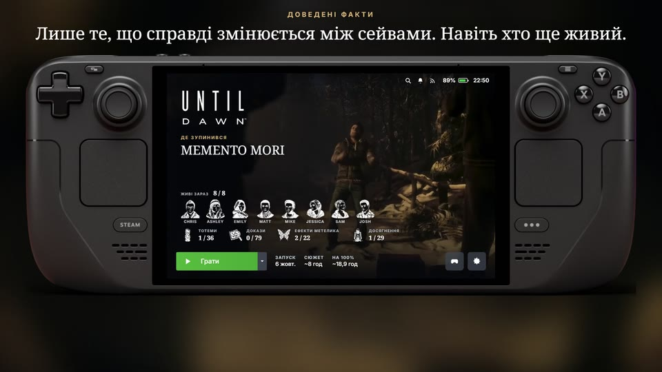
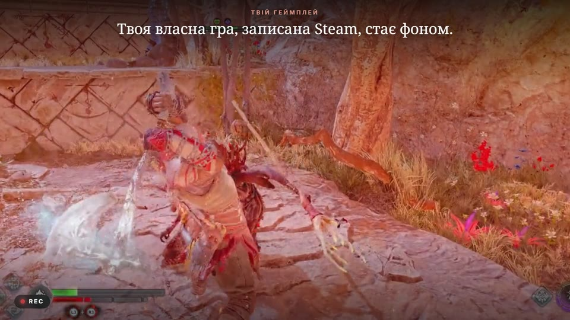
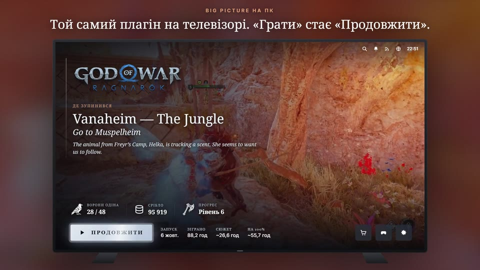
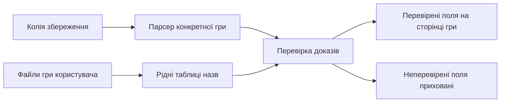

<div align="center">



[English](README.md) · **Українська** · [Русский](README.ru.md)


**Згадай пригоду. Продовж із місця, де зупинився.**

</div>

> **Публічна альфа · Steam Deck: встановлення із ZIP/URL через Decky · ПК/Big Picture — згодом, пакет ще не пройшов приймання на чистій Windows.**

Continue? додає на сторінку гри у Steam останні підтверджені розділ, місце, мету та корисні факти зі збереження. Повернувся за тиждень? Пригадай, де зупинився, перш ніж натиснути «Продовжити». Для тла можна обрати трейлер Steam, трейлер YouTube за твоєю згодою, власний запис Steam Game Recording або статичне зображення.

[Встановлення на Steam Deck](docs/install-deck.uk.md) · [Останній реліз](https://github.com/Alexsander720/continue/releases/latest) · [Пам’ятка альфа-тестувальника](docs/alpha-testers.uk.md) · [Запустити вітрину](docs/preview.uk.md)

<div align="center">



<a href="docs/img/tour-uk.mp4"><b>▶ Дивитися тур у Full HD</b></a>

<sub>Демонстрація інтерфейсу в офіційному корпусі Steam Deck OLED. Тут вибрані знімки збережень; підключення до твого акаунта Steam немає.</sub>

</div>

<details>
<summary>На цій сторінці</summary>

- [Навіщо Continue?](#why)
- [Що вміє публічна альфа](#capabilities)
- [Головне](#screenshots)
- [Підтримувані читачі збережень](#games)
- [Мови](#languages)
- [Встановлення, оновлення та видалення](#install)
- [Звіт альфа-тестувальника](#report)
- [Браузерна вітрина](#showcase)
- [Звідки беруться факти](#evidence)
- [Батарея та продуктивність](#battery)
- [Перевірки для розробників](#development)
- [Що далі](#roadmap)
- [Запитання](#faq)
- [Підтримати](#support)
- [Ліцензія та авторство](#license)

</details>

<a id="why"></a>

## Навіщо Continue?

Steam показує, яка гра в тебе є і коли ти її запускав. Continue? додає контекст, з яким простіше **продовжити саме проходження**:

- **Повернутися в історію:** збережений розділ, область і завдання, якщо гра їх зберігає.
- **Згадати прогрес:** знахідки, спорядження, валюта або персонажі, що вижили — залежно від гри.
- **Насолодитися бібліотекою:** власний записаний геймплей або трейлер за логотипом, оформлення гри та необов'язкова музична тема.
- **Залишитися на дивані:** інформація на сторінці гри, поруч зі звичними кнопками Steam.

<a id="capabilities"></a>

## Що вміє публічна альфа

- Самодостатній плагін Decky: для роботи на Деку помічник на ПК не потрібен.
- Інтерфейс EN, UK та RU. Назви зі збережень беруться з гри або сейва, коли це доведено; якщо гра не має підтвердженого українського тексту, читач залишає перевірений англійський.
- Джерело тла окремо для кожної гри: Steam, YouTube, Steam Game Recording або зображення. Завантаження з YouTube і музики теми потребують двох окремих явних згод.
- Пресети «Легкий», «Збалансований» і «Максимум». Перші два обмежують відео 720p, «Максимум» — 1080p. Ліміт кешу обирається окремо: 1, 2, 4 або 8 ГБ.
- Живе тло на сторінці гри та, якщо дозволяє пресет, на головній Steam.
- Необов'язковий індикатор яскравості; за наявності окремого Brightness Bar дублювання вимикається.
- Щоденна перевірка релізів. Плагін передає Decky ZIP релізу та відповідний SHA-256, а не замінює власні файли сам.
- **«Зібрати звіт для розробника»** у меню `…`: перед збереженням ZIP видно весь знеособлений JSON.

Плагін лише читає збереження й ніколи не записує в них. Показується стан останнього сейва, тому незбережені події можуть бути відсутні.

<a id="screenshots"></a>

## Головне

Це вибрані кадри демонстрації інтерфейсу. Кадр Big Picture показує прототип; приймання Windows ще попереду. Тур і знімки екрана не доводять усі поля читачів.

<table>
<tr>
<td width="33%"></td>
<td width="33%"></td>
<td width="33%"></td>
</tr>
<tr>
<td valign="top"><b>Контекст і факти</b><br>Until Dawn: розділ, знахідки й персонажі, що вижили.</td>
<td valign="top"><b>Власний геймплей</b><br>God of War Ragnarök: запис Steam автора за логотипом.</td>
<td valign="top"><b>Прототип Big Picture</b><br>Приклад компонування для телевізора; пакет для ПК ще не пройшов приймання на чистій Windows.</td>
</tr>
</table>

<a id="games"></a>

## Підтримувані читачі збережень

Поля нижче взято із зафіксованих golden-еталонів. Відсутні у фікстурі значення не вигадуються.

|   | Гра | Доведені поля в golden-еталонах |
| :-: |---|---|
| — | Alan Wake | місце, розділ; термоси, скрині, піраміди з бляшанок, ТБ, радіо та знаки |
|  | Clair Obscur: Expedition 33 | місце, розділ, мета; рівні групи, сюжет і час сейва |
|  | God of War Ragnarök† | читача додано; локальної фікстури для цього golden-прогону не було |
|  | Hollow Knight | місце; завершення, час, гео, маски, цвях, закляття, здібності, амулети, гусінь і мрійники |
|  | Horizon Forbidden West | текст завдання як місце/розділ; рівень Елой і час гри |
|  | Inscryption | колода, життя, зуби та найбільша шкода |
|  | It Takes Two | місце, розділ; група розділу та відкриті мініігри |
|  | Life is Strange 2 | місце, розділ; епізод, завершені епізоди, сувеніри, щоденник, братерство й мораль |
|  | Life is Strange: Double Exposure | місце, розділ; епізод і фотографії |
|  | Little Nightmares | місце, розділ; номи, статуетки та предмети DLC |
|  | Little Nightmares II | місце, розділ і час сейва |
|  | Marvel's Spider-Man 2 | місце, розділ, мета; відсоток, рівень, сюжет, фото, схованки Бродяги та павуки-боти |
|  | NieR:Automata | місце, розділ; персонаж, маршрут, рівень, золото, завдання, зброя та фінали |
|  | Nine Sols | місце; час, рівень, смерті, печатки, навички, нефрити та енциклопедія |
|  | REANIMAL | місце, розділ; номер розділу, час, знахідки, маски й плакати |
|  | SILENT HILL 2 | місце; здоров'я, набої, лікування, вбивства, зброя, мапи й записки |
|  | Slay the Spire | акт/поверх, персонаж, сходження, перемоги, здоров'я й золото |
|  | The Last of Us Part II Remastered† | читача додано; локальної фікстури для цього golden-прогону не було |
|  | UNDERTALE | область; LV, HP, G, час, убивства, зброя та броня |
| — | Uncharted: Legacy of Thieves Collection | розділ; завершення, скарби та час гри |
|  | Until Dawn | місце, розділ; уцілілі, ефекти метелика, докази й тотеми |

 **Hogwarts Legacy — лише ПК.** Для збережень зі стисненням Oodle потрібен нативний модуль `ooz`, якого немає в Python Decky. Підтримку на Steam Deck виключено до появи переносимого Oodle-декомпресора.

† Golden-тест навмисно пропускає читача, якщо дослідницької фікстури немає. Обидва читачі входять до збірки, але таблиця не обіцяє поля, яких не було в поточному golden-прогоні.

Sally Face та Alice: Madness Returns не зареєстровані: наявні матеріали не підтверджують роботу читача на потрібних етапах. Читачі ENSLAVED, LEGO Harry Potter і Bleach також вилучені з публічної збірки.

<a id="languages"></a>

## Мови

Інтерфейс плагіна безпосередньо перекладено англійською, українською та російською. Дані читачів суворіші: назва має бути доведена сейвом або локалізованими файлами гри. Тому поле може залишитися англійським, якщо у встановлених даних гри немає підтвердженого українського рядка. Так працює Uncharted: архів із позначкою `uke` містить англійський текст, отже український режим навмисно показує перевірені англійські розділи.

<a id="install"></a>

## Встановлення, оновлення та видалення

**Steam Deck:** завантаж `continue-deck-<версія>.zip` і відповідний `.sha256` із [останнього релізу](https://github.com/Alexsander720/continue/releases/latest). ZIP не потрібно розпаковувати. Альфи ще немає в магазині Decky. Встанови ZIP або пряме посилання на цей файл через **Decky → Налаштування → Розробник → Встановити з URL/ZIP**. Під час поширення релізу контрольна сума має бути поруч із ZIP. Встановлення, відновлення, оновлення й видалення описано в [інструкції для Steam Deck](docs/install-deck.uk.md).

У списку плагінів Decky назва — **Continue** (Decky не завантажує назви з `?`); у самому інтерфейсі — **Continue?**.

**Windows / Big Picture — згодом.** Окремий пакет `continue-pc-<версія>.zip` та встановлювач `setup.cmd` перевірено на фікстурах: встановлення у профіль без прав адміністратора, відновлення, status, відкат оновлення й видалення. Приймання на чистій Windows зі справжнім Steam, SmartScreen та антивірусом ще попереду. До релізу для Deck цей пакет не входить. В [інструкції для ПК](docs/install-pc.uk.md) описано локальний налагоджувальний прапорець Steam, згоду на нього, встановлення та видалення.

<a id="report"></a>

## Звіт альфа-тестувальника

Відкрий меню `…` Continue? і вибери **«Зібрати звіт для розробника»**. У попередньому перегляді будуть доступні версії, мова й налаштування, кінець журналу, результати читачів встановлених ігор із часом розбору та стан кешу тла. Сейви й медіа до ZIP не додаються; імена, шляхи профілю та Steam ID приховуються. Перевір текст, збережи ZIP на Стільницю або в Завантаження й додай його до [шаблону звіту](.github/ISSUE_TEMPLATE/alpha_tester_report.uk.md).

Перед перевіркою прочитай [пам'ятку альфа-тестувальника](docs/alpha-testers.uk.md).

<a id="showcase"></a>

## Браузерна вітрина

Сайт — це набір фіксованих прикладів, а не підключення до Steam:

```text
python tools/preview.py
```

Відкрий <http://127.0.0.1:8811/>. Обліковий запис Steam і встановлені ігри не потрібні. У вітрині 20 інтерактивних знімків; у каталозі публічної альфи 22 читачі.

<a id="evidence"></a>

## Звідки беруться факти

Порядок читання: **копія збереження → розбір відомих полів → назви з твоїх файлів гри → лише підтверджені факти на екрані**. Це збережений стан; події після останнього збереження тут не з'являються.



- **Спочатку значення числа.** Порівнюємо етапи одного проходження й перевіряємо, що саме означає поле. Успішна автоматична перевірка сама по собі не доводить, що зміщення — це «знахідки».
- **Назви з гри.** Без розділів із пам'яті та непомітного перекладу ШІ. Якщо підтвердженого перекладу немає, зберігаємо мову джерела й підписуємо її.
- **Загальні кількості з рідних даних.** Для «12 / 40» потрібні докази обох частин. Число з вікі або номер останнього відкритого розділу не замінюють поточний збережений розділ.
- **Лише читання, локально.** Розбираються копії; не записуємо у збереження, папки й процеси ігор. Браузерне демо використовує готові знімки та не читає сейви відвідувача.

Публічна альфа містить читачі на Python для окремих ігор і вибрані таблиці назв для карток. Правила внеску — в [AGENTS.md](AGENTS.md) та [CONTRIBUTING.md](CONTRIBUTING.md); непідтверджені поля залишаються прихованими.

<a id="battery"></a>

## Батарея та продуктивність

Попередній замір на **Steam Deck OLED автора, 6 жовтня 2026**: витрати всього пристрою від батареї, середнє за 45 секунд, яскравість 13%, Wi-Fi увімкнений.

| Екран | Потужність |
|---|---:|
| Сторінка гри, нерухоме тло | 4,93 Вт |
| Сторінка гри, петля 1080p + музика | 6,46 Вт |
| Головна Steam без нашого відео | 7,69 Вт |
| Головна Steam, петля + музика | 8,07 Вт |

За цих умов жива сторінка додала близько **1,5 Вт**. Це короткий замір конкретного екрана, **не тест часу роботи в грі**. Оцінки годин на сайті розраховані для батареї 50 Вт·год за такого екрана; реальна гра споживає енергію по-своєму.

В альфі вже є пресети **«Легкий», «Збалансований» і «Максимум»**. За замовчуванням обрано «Легкий»: без відео на головній і зі статичним тлом від батареї. Перші два обмежують відео 720p, «Максимум» — 1080p. Ліміт кешу обирається окремо: 1, 2, 4 або 8 ГБ. Налаштування описано в [інструкції для Steam Deck](docs/install-deck.uk.md); попередні заміри вище не гарантують час роботи альфи від батареї.

<a id="development"></a>

## Перевірки для розробників

```text
python tools/check_links.py
node --check site/app.js
node --check site/data.js
python tools/preview.py
```

Зміни читачів порівнюються з детермінованими JSON golden-еталонами. Вони оновлюються лише явною командою `--update`; звичайний тест ніколи не переписує базу.

<a id="roadmap"></a>

## Що далі

Далі — приймання на чистих Deck LCD та OLED: встановлення, оновлення й видалення, фокус контролера, сон і пробудження, робота без мережі, статичне тло у разі збоїв та ліміти кешу. Windows / Big Picture перед випуском потребує окремого приймання на чистому ПК зі справжнім Steam.

Решту перевірок наведено в [дорожній карті](docs/ROADMAP.md), випущені зміни — у [журналі](CHANGELOG.md). Строків і сумісності наперед не обіцяємо.

<a id="faq"></a>

## Запитання

<details>
<summary><b>Можна вже встановити Continue?</b></summary>

Так, на Steam Deck: встанови ZIP [останнього релізу](https://github.com/Alexsander720/continue/releases/latest) через Decky за [інструкцією](docs/install-deck.uk.md). Windows / Big Picture — згодом: окремий пакет ще не пройшов приймання на чистій Windows.

</details>

<details>
<summary><b>Підтримується будь-яка гра?</b></summary>

Для розділів і фактів потрібен читач конкретної гри та докази. Дивись [таблицю читачів](#games), зокрема примітки про відсутні фікстури й обмеження Oodle на Деку. Запис у бібліотеці сам по собі не додає підтримки збережень.

</details>

<details>
<summary><b>Числа у браузерному демо оновлюються з мого Steam?</b></summary>

Ні. Усі 20 інтерактивних прикладів — фіксовані знімки. Вітрина не підключається до Steam і не читає твої сейви; встановлений плагін читає останнє локальне збереження.

</details>

<details>
<summary><b>ШІ вгадує мій прогрес?</b></summary>

Показані факти підтверджуються збереженнями та файлами гри. ШІ-агент може допомогти дослідити читач, але правдоподібна відповідь сама по собі не є доказом.

</details>

<details>
<summary><b>Чому в клоні немає кнопки музики?</b></summary>

Музику тем не включено до Git. Демо приховує кнопку, якщо локального файлу теми немає. У плагіні завантаження музики теми та трейлерів YouTube потребують двох окремих явних згод.

</details>

<details>
<summary><b>Працюватиме після будь-якого оновлення Steam?</b></summary>

Плагін залежить від інтерфейсу Steam, тому після оновлень клієнта треба перевіряти сумісність. Альфа не гарантує роботу з кожною версією. Для звіту про проблеми скористайся [пам’яткою тестувальника](docs/alpha-testers.uk.md).

</details>

<details>
<summary><b>Як допомогти проєкту?</b></summary>

Повідомити про помилку альфи чи вітрини, поліпшити переклади, описати шляхи збережень або підготувати докази за кількома етапами одного проходження. Перед надсиланням файлів прочитай [CONTRIBUTING.md](CONTRIBUTING.md).

</details>

<a id="support"></a>

## Підтримати

Continue? безкоштовний і таким залишиться. Якщо він повернув тобі бажання пограти — можна допомогти проєкту жити:
кожен донат іде в розробку й у підписку на ШІ, з яким він будується.

<table align="center"><tr>
<td align="center"><br><b>Банка monobank</b></td>
<td align="center"><br><b>USDT · TRC20</b></td>
<td align="center"><br><b>USDT · BEP20</b></td>
</tr></table>

- **Банка monobank** — <https://send.monobank.ua/jar/3zsHTXdRbt> · картка банки `4874 1000 3320 3608`
- **PayPal** — [незмінені реквізити на сайті проєкту](https://alexsander720.github.io/continue/#support)
- **USDT · TRC20** (Tron) — `TKhmtVEnuU5w73YMPT8adh7t3VZKJUUxmC`
- **USDT · BEP20** (BNB Smart Chain) — `0xDC0c682922bF3194693774743fBB3fd20E7754c3`

<a id="license"></a>

## Ліцензія та авторство

Код — **GNU GPL v3** з наявними умовами розділу 7 у [NOTICE.md](NOTICE.md): зберігати авторство, позначати зміни та використовувати іншу назву/логотип для поширюваного форка. Текст ліцензії: [LICENSE](LICENSE).

Назви, логотипи, ілюстрації й відео ігор зберігають права їхніх власників; ліцензія коду не передає прав на ці медіа. Ігрові значки та портрети персонажів використовуються в інформаційних некомерційних цілях (запити на вилучення приймаються через issue tracker). Трейлери YouTube й музика тем завантажуються лише за твоєю згодою, локально на твоєму пристрої; проєкт не постачає сторонні аудіо та відео. Корпус у вітрині — офіційний рендер Steam Deck OLED від Valve. [Джерела ресурсів](site/img/ASSET_SOURCES.md) · [Джерела демо](site/DEMO_SOURCES.md). Continue? — незалежний проєкт, не пов'язаний із Valve.

**Continue? by Doctor_Nerd — https://github.com/Alexsander720/continue**

<div align="center"><sub>Зроблено в Україні, автор — Doctor_Nerd · <a href="https://github.com/Alexsander720">@Alexsander720</a></sub></div>
